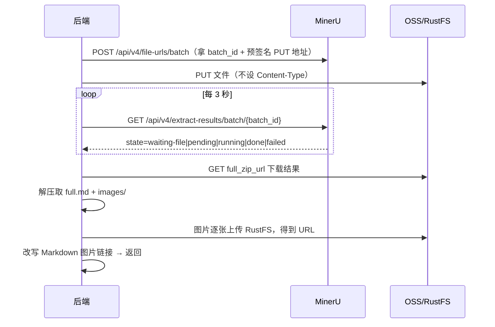

# MinerU 解析文档 v20 总结

> 课程 68 · 后端 `knowledge-hub-backend`（v20）· 前端 `knowledge-hub-frontend`（v20）
> 整理时间：2026-11-17

## 一句话

把 RAG 上游最脏的活（PDF / 扫描件 / Office → 结构化 Markdown）外包给 MinerU：**上传 → 轮询 → 拿 zip → 解压取 `full.md` → 图片转存 RustFS 并改写链接**，前端再用一套支持公式和 HTML 表格的渲染器展示。

## 为什么解析决定 RAG 的天花板

```
解析质量差 → 切分错 → 向量语义错 → 召回错 → 生成错
```

后面每一环都在放大误差。所以这一讲不是"接个 SDK"，而是**把解析产物变成可检索、可展示、可追溯的 Markdown**。

## 两条 API（选型）

| 维度 | 精准解析 API | Agent 轻量解析 API |
|---|---|---|
| Token | 需要（页面创建，最多 5 个，90 天不可续期） | 无需，按 IP 限频 |
| 接口 | `/api/v4/file-urls/batch`、`/api/v4/extract-results/batch/{id}` | `/api/v1/agent/parse/file` |
| 模型 | `pipeline` / `vlm` / `MinerU-HTML` | 固定轻量 pipeline |
| 限制 | < 200MB / ≤ 200 页 | < 10MB / ≤ 20 页 |
| 场景 | 生产入库、复杂版式 | 快速验证 |

限流：提交类 50 文件/分钟、5000 文件/天；查询类 1000 次/分钟。

## 代码地图（V20）

| 文件 | 行数 | 角色 |
|---|---:|---|
| `src/document/parser/mineru.parser.ts` | 345（新） | 完整解析流程 + 图片转存 + 链接改写 |
| `src/document/parser/file-parser.service.ts` | 138 → 100 | 扩展名分派：MinerU 或本地纯文本 |
| `src/document/document.module.ts` | +2 | 注册 `MineruParser` |
| `src/document/document.controller.ts` | 1 | 上传上限 50MB → 200MB |
| `src/ai/ai-stream.service.ts` | 6 | 检索上下文取消 800 字截断 |
| `src/ai/ai-chat.service.ts` | 6 | 同上 |
| `src/ai/chat-query-rewrite.service.ts` | 5 | 评估摘录取消 180 字截断 |
| `src/components/DocumentMarkdown.tsx` | 43（新） | 公式 + HTML 表格渲染 |

## ① 解析分派

```ts
const MINERU_EXTENSIONS = new Set([
  'pdf', 'png', 'jpg', 'jpeg', 'jp2', 'webp', 'gif', 'bmp',
  'doc', 'docx', 'ppt', 'pptx', 'xls', 'xlsx',
]);
const LOCAL_TEXT_EXTENSIONS = new Set(['txt', 'md']);
```

**只有 txt/md 走本地**，其余全部 MinerU。v19 及之前的 `parsePdf/parseDocx/parsePptx/parseXlsx` 不再被引用。

白名单要显式列全，否则会出现"上传成功但提示不支持"。

## ② 四步解析时序



### 状态机（实测）

```
waiting-file  文件还没传到 → 正常几秒内变 pending
pending       排队
running       解析中（可读 extract_progress 页数）
done          完成，返回 full_zip_url
failed        err_msg 给出原因
```

代码只在**状态变化时**打日志：

```ts
if (state !== lastState) {
  logger.log(`MinerU 解析状态: batch=${batchId}, state=${state}${pages}`);
  lastState = state;
}
```

解析几十秒的文档，如果每秒都打日志会刷屏。

## ③ 图片处理（本讲最容易漏）

`full.md` 里的图片是**相对路径**（`images/xxx.jpg`），浏览器和检索都访问不到。

```ts
// 只处理 Markdown 里真的引用到的图片
const imageEntries = zip.files.filter((entry) => {
  const rel = relativeImagePath(mdEntry.name, entry.name);
  return markdown.includes(rel) || markdown.includes(`./${rel}`);
});
```

三个细节：

| 细节 | 为什么 |
|---|---|
| `relativeImagePath` 用 `path.posix` | zip 内路径是 `/`，Windows 的 `\` 会算错 |
| 过滤 `__MACOSX/`、`.DS_Store` | macOS 打 zip 会带垃圾文件 |
| RustFS 未启用时**抛错** | 否则 md 里留死链，用户看到破图 |

上传后改写：

```ts
export function rewriteImageUrls(markdown, urlByPath) {
  // 同时匹配 ./images/x 与 images/x，长的先替换，避免前缀互相覆盖
  replacements.sort((a, b) => b[0].length - a[0].length);
  ...
}
```

## ④ 模型选择与降级（实战）

MinerU 有 `vlm` 和 `pipeline` 两个模型：

| 模型 | 优点 | 缺点 |
|---|---|---|
| `vlm` | 版面还原好、表格结构准 | 个别 PDF 直接解析失败 |
| `pipeline` | 稳定 | 复杂版面质量略低 |

**实测**：`example.pdf`（13 页）用 `vlm` 稳定失败：

```
state=failed  err_msg="retry limit reached (5 attempts), please replace the file"
```

同一个文件换 `pipeline` → 24 秒成功。同 Token、同网络、同上传代码，**唯一变量是模型**。

所以加了自动降级：

```ts
const candidates = primary === 'pipeline' ? ['pipeline'] : ['vlm', 'pipeline'];
for (const model of candidates) {
  try { ... return markdown; }
  catch (e) {
    if (!(e instanceof MineruParseFailedError) || 没有下一个候选) throw;
    logger.warn(`MinerU ${model} 解析失败，降级到 ${next} 重试：${e.message}`);
  }
}
```

**关键**：用一个专门的 `MineruParseFailedError` 区分"模型/文件问题"和"配置/网络问题"——缺 Token、上传失败、超时都不该重试。

## ⑤ 检索侧配套改动

MinerU 解析出的文档更完整（公式、表格），但旧的截断会砍掉内容：

```diff
- const snippet = hit.content.length > 800 ? `${hit.content.slice(0, 800)}...` : hit.content;
+ return `[${i + 1}] ${documentTitle}${heading}\n${hit.content}`;
```

三处一起改：`ai-stream`（上下文）、`ai-chat`（上下文）、`chat-query-rewrite`（切题评估的摘录 180 字）。

**取舍**：上下文变长 → 更贵、更慢，但表格/公式被截断会导致答错。对知识库场景，正确性优先。

## ⑥ 前端渲染

`DocumentMarkdown.tsx`（新增）：

```tsx
<Markdown
  remarkPlugins={[remarkGfm, remarkMath]}
  rehypePlugins={[rehypeRaw, rehypeSanitize, [rehypeKatex, { throwOnError: false }]]}
  components={{ table: 包一层横向滚动容器, img: 自适应, a: 新窗口 }}
/>
```

| 插件 | 为什么需要 |
|---|---|
| `remark-gfm` | 表格、删除线等 GFM 语法 |
| `remark-math` + `rehype-katex` | MinerU 输出 LaTeX 公式（`$$...$$`） |
| `rehype-raw` | MinerU 表格是 **HTML `<table>`**，默认 Markdown 解析会当纯文本 |
| `rehype-sanitize` | 允许 raw HTML 就必须消毒，否则是 XSS 入口 |

`DocumentsPage` 加了上传态：解析要几十秒，用户必须有反馈。

```tsx
const pending = message.loading('正在解析，请留在此页', 0);
<Button loading={uploading}>{uploading ? '解析中' : '上传解析'}</Button>
```

**注意跳转也改了**：`/documents/:id/edit` → `/documents/:id`（解析完先看结果，不是直接进编辑）。

## 配置

```bash
MINERU_API_TOKEN=            # 必须，90 天过期
MINERU_API_BASE=https://mineru.net
MINERU_MODEL_VERSION=vlm     # 失败会自动降级 pipeline
MINERU_LANGUAGE=ch
MINERU_ENABLE_FORMULA=true
MINERU_ENABLE_TABLE=true
MINERU_POLL_INTERVAL_MS=3000
MINERU_POLL_TIMEOUT_MS=600000
```

## 改动清单

后端 6 文件 +409/−96（含新 parser 345 行）；前端 5 文件 +388/−9（含 5 个新依赖：`katex`、`rehype-katex`、`rehype-raw`、`rehype-sanitize`、`remark-math`）。

## 易错点

| 坑 | 说明 |
|---|---|
| 上传时带 `Content-Type` | 预签名 URL 可能拒绝 |
| 图片相对路径不替换 | 前端全是破图 |
| RustFS 未启用仍继续 | 留下死链，不如直接报错 |
| Windows 用 `path` 而非 `path.posix` | zip 内路径是 `/`，会算错 |
| 轮询每轮都打日志 | 几十秒的文档会刷屏 |
| `MINERU_POLL_TIMEOUT_MS` 没设 | 任务卡在 `processing` 时永远轮询 |
| 解析完同步做向量化 | 请求挂几十秒，必须走 MQ |
| `is_ocr` 一律 false | 扫描件抽不出字 |
| 表格强行转 Markdown | 丢 `colspan`，应保留 HTML |
| 模型写死 `vlm` | 个别文件永远失败，要降级 |
| 前端不用 `rehype-raw` | HTML 表格被当纯文本 |
| 用了 raw 却不 sanitize | XSS 风险 |
| Token 90 天过期 | 生产要做轮换/告警 |

## 验收

| 检查点 | 期望 |
|---|---|
| 上传 PDF | 进度提示「正在解析」 |
| 解析成功 | 自动跳详情页，正文含标题层级 |
| 表格 | 渲染成真表格，可横向滚动 |
| 公式 | KaTeX 正常渲染 |
| 图片 | 地址指向 RustFS，不是 `images/xxx` |
| 扫描件 | `is_ocr: true` 后有文字 |
| vlm 失败的 PDF | 日志出现"降级到 pipeline"，最终成功 |
| 缺 Token | 400 + 可读提示，不是 500 |

## 主动回忆

1. **为什么图片必须转存对象存储？**
   解析产物里的图片是 zip 内相对路径，浏览器和检索都访问不到；转存后才有稳定 URL。

2. **`is_ocr` 什么时候必须开？开了还差什么？**
   扫描件必须开，否则抽不到文字层；开了只得到纯文本，表格/公式/标题层级仍可能丢失。

3. **为什么 vlm 失败时换 pipeline 能成功？**
   两个是不同模型：vlm 走视觉大模型，对个别版面会重试 5 次后放弃；pipeline 走传统 OCR 流水线，容错更高。所以降级是"换实现"，不是"重试"。

4. **哪种错误不该重试？**
   缺 Token、上传失败、轮询超时、接口 4xx——这些与模型无关。所以要用专门的错误类型区分。

5. **前端为什么要 `rehype-raw` + `rehype-sanitize` 同时用？**
   MinerU 的表格是 HTML `<table>`，不加 raw 会被当纯文本；允许 raw 就引入 XSS 面，必须 sanitize。

## 关联

- [[68-MinerU解析文档]] —— 课程精读
- [[67-LangFuse评测与Tracing]] —— 上一讲
- 前一篇：`docs/LangFuse评测与Tracingv19总结.md`
