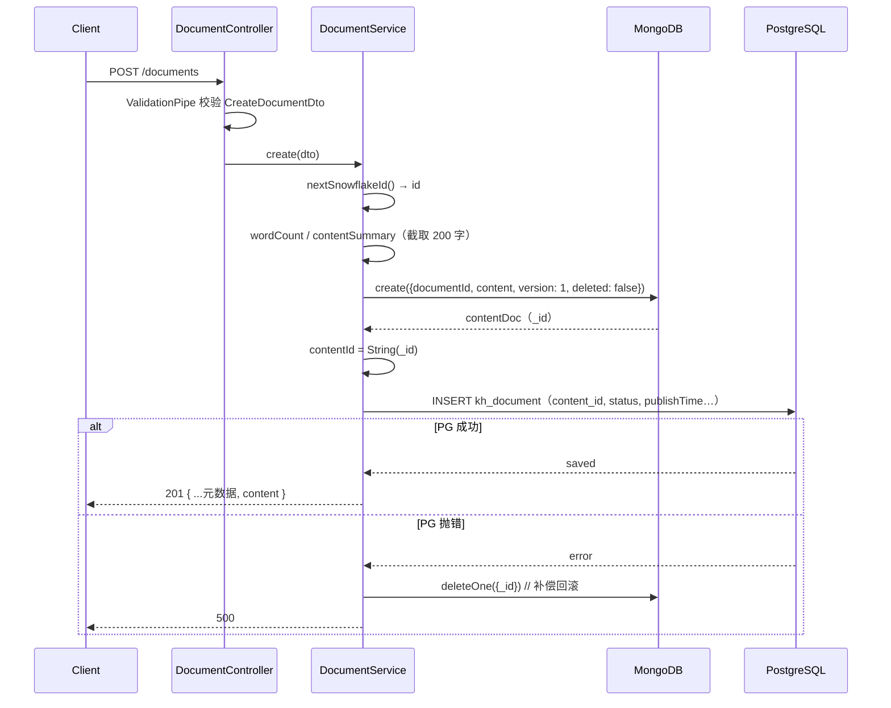

# 文档模块 v1 总结（PostgreSQL + MongoDB 分层存储）

> 对应课程：49 企业级知识库项目 · 文档模块数据库设计
> 代码基线：`ai-agent-code/knowledge/knowledge-hub-backend`（学习项目，v1 已完成）
> 技术栈：Nest 12 + TypeORM + Mongoose + ESM + vitest/oxlint
> 整理时间：2026-10-22

---

## 0. 一页速览

v1 只做一件事：**把文档拆成「业务元数据 + Markdown 正文」两半，分别放进 PG 和 MongoDB，用双向 ID 绑在一起，并提供 CRUD 接口。**

| 维度 | 结论 |
|---|---|
| 元数据 | PostgreSQL `kh_document`，TypeORM 映射，`synchronize: false`（表结构由 `init-scripts/postgresql/init.sql` 建） |
| 正文 | MongoDB `document_content`，Mongoose 映射，单文档存整篇 Markdown |
| 主键 | 应用层生成雪花 ID（string），存 PG `BIGINT` |
| 关联 | `kh_document.content_id`（字符串 "24 位 ObjectId"）↔ `document_content._id`；`document_content.documentId`（雪花 ID 字符串）↔ `kh_document.id` |
| 接口 | `POST/GET /documents`、`GET/PATCH/DELETE /documents/:id`（公开路径用复数） |
| 删除 | 双端软删（`deleted=true`），不物理删除 |
| 一致性 | 写 PG 失败回滚 Mongo（补偿事务）；**没有**跨库事务、没有对账任务、没有幂等 |
| 未落地 | RustFS 原件、格式转换、异步索引（ES/Milvus/图）、状态机审核、鉴权 |

```
                 ┌──────────────────────────────┐
   POST /documents│  ValidationPipe（全局）       │
        ─────────►│  whitelist + transform       │
                 │  forbidNonWhitelisted        │
                 └──────────────┬───────────────┘
                                │ CreateDocumentDto
                    ┌───────────▼────────────┐
                    │   DocumentService       │
                    │  create / findAll ...   │
                    └───┬────────────────┬────┘
        ┌───────────────▼──┐        ┌────▼──────────────────┐
        │ MongoDB          │        │ PostgreSQL            │
        │ document_content │◄──────►│ kh_document           │
        │ _id, content     │  ID 关联│ id, content_id, status│
        └──────────────────┘        └───────────────────────┘
```

### 0.1 运行口径（这份总结对应的那份代码）

| 项 | 值 |
|---|---|
| 项目路径 | `ai-agent-code/knowledge/knowledge-hub-backend` —— **学习项目**，本文档以此为准 |
| 对照代码 | `ai-agent-code/knowledge-hub-backend` —— 课程提供的对照版本，只读参考，不要在这边改 |
| 启动 | `pnpm start:dev`（`nest start --watch`，改文件会自动重启）；测试走 `pnpm test`（vitest） |
| 模块体系 | **ESM**：`package.json` 有 `"type": "module"`，`tsconfig` 为 `nodenext`，所有相对 import 必须带 `.js` |
| PostgreSQL | 容器内 5432 → 宿主 **15432**（5432 被 Windows NAT 预留绑不上），`.env` 里 `POSTGRES_PORT=15432` |
| MongoDB | `localhost:27017`，认证库 `admin`，业务库 `knowledge_hub` |
| 可视化管理 | pgAdmin `localhost:8088`、mongo-express `localhost:8081` |
| 目录差异 | 正文 schema 在 `src/document/schema/`、transformer 在 `src/common/transformer/`（对照代码是 `schemas/`、`transformers/`） |
| 接口手测 | 用例在 `docs/curl/curl.md`，Postman/Apifox 直接抄 |

> 两份代码逻辑一致但工程化路线不同（对照代码是 CommonJS + jest + Nest 11）。**排查问题时先确认改的是哪一份**，最简单的方法是看启动日志里的文件路径。

---

## 1. 数据模型

### 1.1 PostgreSQL：`kh_document`

来自 `init-scripts/postgresql/init.sql`，实体在 `src/document/entities/document.entity.ts`。

| 列 | 类型 | 实体属性 | 说明 |
|---|---|---|---|
| `id` | BIGINT PK | `id` | 雪花 ID，JS 侧用 string |
| `title` | VARCHAR NOT NULL | `title` | 标题 |
| `content_id` | VARCHAR NOT NULL **UNIQUE** | `contentId` | 指向 Mongo `_id`，一对一兜底 |
| `summary` | VARCHAR | `summary` | 摘要（用户填或截取正文） |
| `category_id` / `team_id` / `author_id` | BIGINT | `categoryId` / `teamId` / `authorId` | 分类、团队、作者 |
| `cover_image` | VARCHAR | `coverImage` | 封面图 URL |
| `tags` | VARCHAR | `tags` | 逗号分隔标签（不是数组） |
| `status` | SMALLINT NOT NULL DEFAULT 0 | `status` | 0 草稿 / 1 已发布 / 2 已归档 |
| `remark` | VARCHAR | `remark` | 备注 |
| `view_count` / `like_count` / `comment_count` / `favourite_count` | INT DEFAULT 0 | 同名驼峰 | 计数器冗余在元数据表 |
| `word_count` | INT DEFAULT 0 | `wordCount` | 正文字数（写入时算好） |
| `publish_time` | TIMESTAMP | `publishTime` | 首次发布时写入 |
| `is_public` | BOOLEAN DEFAULT false | `isPublic` | 是否公开 |
| `created_at` / `updated_at` | TIMESTAMP | `createdAt` / `updatedAt` | `@CreateDateColumn` / `@UpdateDateColumn` |
| `create_by` / `update_by` | BIGINT | `createBy` / `updateBy` | 操作人 |
| `deleted` | BOOLEAN DEFAULT false | `deleted` | 软删 |

```ts
export enum DocumentStatus {
  Draft = 0,      // 草稿
  Published = 1,  // 已发布
  Archived = 2,   // 已归档，不参与检索
}
```

> 用 `SMALLINT` 而不是 PG 原生 enum：加状态不需要 `ALTER TYPE`，跨语言解析也简单；代价是可读性差，要靠代码里的 enum 兜住。

### 1.2 MongoDB：`document_content`

来自 `src/document/schema/document-content.schema.ts`。

| 字段 | 类型 | 说明 |
|---|---|---|
| `_id` | ObjectId | 被 PG 的 `content_id` 引用 |
| `documentId` | String（required，index） | 反向指向 `kh_document.id`，只知道文档 ID 时可直接查正文 |
| `content` | String（required） | 整篇 Markdown |
| `contentLength` | Number | 字符数，用于统计/展示，不必读全文 |
| `contentSummary` | String | 预览摘要（最长 200 字符 + `...`） |
| `version` | Number（默认 1） | 正文版本号，每次改正文 `$inc: 1` |
| `deleted` | Boolean | 软删 |
| `createdAt` / `updatedAt` | Date | `timestamps: true` 自动维护 |
| （无 `__v`） | — | `versionKey: false` |

索引（`init-scripts/mongodb/init.js`）：

```js
db.document_content.createIndex({ documentId: 1 }, { unique: true })
db.document_content.createIndex({ deleted: 1 })
```

> 注意：`unique` 只写在 `init.js` 里，schema 上的 `@Prop({ index: true })` 不带 unique。**如果没跑 init 脚本，组件启动时只会建普通索引，唯一性就丢了** —— 这是容易漏的一处。

### 1.3 为什么两边各存一个方向的外键

- PG 末尾存 `content_id`：查详情时，拿到元数据就能直接按 `_id` 精确取正文 —— 一次索引命中。
- Mongo 存 `documentId`：正文侧也能反查自己属于哪篇文档；做正文修复/对账、日志排查时不用回 PG 全表扫。

两条链路都保证「给任意一个 ID 都能在一步内找到对端」，这是分库设计里最省事的做法。代价是双写，必须靠补偿保证一致（第 5 节）。

---

## 2. 为什么这样分层（四个理由）

1. **读写模式不同**：列表页要筛选、排序、分页，只碰元数据；正文只在详情页/编辑页加载。把大字段放在同一张表里，任何一次列表查询都可能被 `SELECT *` 拖垮。
2. **存储能力匹配**：PG 给事务、唯一约束、组合索引、复杂 `WHERE`；Mongo 给「一篇文章一个文档」的自然建模、稀疏字段、免 schema 迁移和低成本横向扩容。
3. **体量与生命周期不同**：正文是数据量主体（一篇 Markdown 可能几百 KB），可以独立压缩、归档到冷存储、换库迁移；元数据必须保持小、稳定、可审计。
4. **失败域与成本隔离**：正文写失败不应影响元数据检索能力；正文存储成本远低于 PG 的行存储和索引成本。

> 课程里的第三层是 RustFS（对象存储）放**上传的原文件**（PDF/DOCX/PPTX）和解析出的图片。v1 没接：现在的正文是「手工输入的 Markdown」，还没有「上传文件 → 解析成 Markdown」这一段，所以暂时没有二进制可放。

---

## 3. 主键与 ID 策略

### 3.1 雪花 ID + `bigintTransformer`

```ts
// src/common/snowflake-id.ts
const snowflake = new snowflakeIdExports.default({   // 注意这个 .default
  mid: Number(process.env.SNOWFLAKE_MACHINE_ID ?? 1),
  offset: Number(process.env.SNOWFLAKE_OFFSET ?? 1704067200000),
});

export function nextSnowflakeId(): string {
  return snowflake.generate();   // 返回 string
}
```

ESM 里引 CommonJS 包，整个 `module.exports` 被当成 `default` 导出，所以拿到的是 `{ default: SnowflakeId }`，必须再取一次 `.default` —— 这一行是 ESM 互操作的典型坑。

雪花 ID 是 64 位整数，**超过 JS `Number.MAX_SAFE_INTEGER`（2^53-1）**。所以：

```ts
// src/common/transformer/bigint.transformer.ts
export const bigintTransformer: ValueTransformer = {
  to: (v) => v,                                  // 写：原样交给驱动
  from: (v) => (v == null ? v : String(v)),      // 读：统一转 string
};
```

- TS 里所有 ID 都声明成 `string`，不出现 `number`。
- 实体里每个 BIGINT 列都挂这个 transformer，避免 `JSON` 返回时精度被吃掉（`1234567890123456789` → `1234567890123456800`）。
- JSON 能安全承载 string，前端也按 string 处理，不做数值运算。

> 如果不用雪花 ID，改用 `BIGSERIAL`，问题是一样的 —— 一旦数值超过 2^53，任何 `number` 都会失真。

> 小隐患：代码读的是 `SNOWFLAKE_MACHINE_ID`，而 `.env` 里写的是 `SNOWFLAKE_WORKER_ID`，两者对不上（当前靠默认值 1 兜住）。多实例部署前要统一。

### 3.2 为什么正文的 `_id` 也当外键用

Mongo 的 `_id` 天然唯一且自带索引，直接拿它当 PG 的 `content_id`，省掉在 Mongo 里再建一套主键。存成 string（`String(contentDoc._id)`）是 24 位 hex，可直接按字符串查 `_id`（Mongoose 会自动转 ObjectId）。

---

## 4. 代码结构

```
src/
├── main.ts                       # 全局 ValidationPipe + listen
├── app.module.ts                 # ConfigModule / TypeORM / Mongoose / DocumentModule
├── common/
│   ├── snowflake-id.ts           # 雪花 ID（string）
│   └── transformer/bigint.transformer.ts
└── document/
    ├── document.module.ts        # MongooseModule.forFeature(DocumentContent)
    ├── document.controller.ts    # @Controller('documents') 5 个路由
    ├── document.service.ts       # 全部业务逻辑（跨库编排都在这里）
    ├── dto/                      # create / update / query
    ├── entities/document.entity.ts
    └── schema/document-content.schema.ts
```

职责边界很清楚：

- **controller**：只管路由和 DTO 绑定，一行业务逻辑都没有。
- **service**：`@InjectEntityManager()` 拿 PG 的 `EntityManager`，`@InjectModel(DocumentContent.name)` 拿 Mongo 的 `Model`，跨库编排全在这里。
- **module**：只注册 `MongooseModule.forFeature`；TypeORM 的实体在 `app.module` 里统一注册，所以 PG 侧不需要在模块里再声明 repository。

### 全局管道

```ts
// main.ts
app.useGlobalPipes(new ValidationPipe({
  whitelist: true,              // 删掉 DTO 未声明的字段
  transform: true,              // 转成 DTO 实例 + query/param 基础类型转换
  forbidNonWhitelisted: true,   // 不删，直接 400
}));
```

在本项目里的实际效果：

- 前端多传字段（比如把整个列表项回传、带上 `id`/`createdAt`）→ `400 property xxx should not exist`。
- `?page=2` 这种字符串 → 必须靠 DTO 上的 `@Type(() => Number)` 才会变成数字，否则 `@IsInt()` 直接挂。
- 请求打到不存在的路径 → Express 层 `404 Cannot POST /xxx`，和校验无关（排查时先分清 404 和 400）。

### ESM 工程约束（这份代码独有）

`"type": "module"` + `moduleResolution: nodenext`，意味着：

- **所有相对 import 必须写扩展名**：`import { DocumentService } from './document.service.js'`，即使源文件是 `.ts`。
- 新增一个文件却忘了加 `.js`，`tsc` 可能不报错，但运行时报 `ERR_MODULE_NOT_FOUND` —— 而且是在启动/首次请求时才炸。
- 引纯 CommonJS 包时注意 default 互操作（见 `snowflake-id.ts`）。

---

## 5. 五条主链路

### 5.1 创建：先 Mongo 后 PG + 回滚



为什么是这个顺序，而不是先写 PG：

- PG 的 `content_id` 是 NOT NULL UNIQUE，必须先有 Mongo 的 `_id` 才能填。
- 反过来「先 PG 后 Mongo」的话，PG 写入成功、Mongo 失败，就要回滚 PG 的 INSERT —— 但那时可能已经触发了别的副作用（自增、触发器、消息）。**先写「可删除、无副作用」的一侧，失败时物理删除，代价最小。**

代价与局限（面试会追问）：

- 回滚本身也可能失败（`deleteOne` 抛错），那就留下孤儿正文，v1 没有对账任务来收尾。
- 这是「补偿事务 / Saga-lite」，不是分布式事务；只保证**大概率**一致。

### 5.2 列表：只查 PG

```ts
const qb = this.em.createQueryBuilder(DocumentEntity, 'doc')
  .where('doc.deleted = :deleted', { deleted: false });
// title ILIKE、category_id、team_id、author_id、status 按需 andWhere
qb.orderBy('doc.created_at', 'DESC').skip((page - 1) * pageSize).take(pageSize);
const [items, total] = await qb.getManyAndCount();
```

- 返回体固定是 `{ items, total, page, pageSize }`。
- **不含正文**，也不做 Mongo 查询 —— 列表页 N 条数据不会产生 N 次 Mongo 请求。
- 坑：QueryBuilder 里的 `orderBy` / `where` 是**字符串 SQL 片段**。写 `doc.created_at`（真实列名）或 `doc.createdAt`（属性名，TypeORM 会翻译）都对；写成 `doc.create_at` 不会被任何一层拦住，直接原样拼进 SQL，最后在 PG 报 `42703 column does not exist` → 500。本项目 v1 就踩过这一下（`document.service.ts` 第 119 行，已修）。

### 5.3 详情：PG + Mongo

```ts
async findOne(id: string, withContent = true)
```

- PG 按 `id + deleted=false` 查，查不到 → `404 Document xxx not found`。
- `withContent=false` 只回元数据（列表/审核等场景省一次 Mongo）。
- 默认再按 `_id = doc.contentId`、`deleted=false` 查正文，拼成 `{ ...doc, content }`。

### 5.4 更新：三个分支

| 变更内容 | 行为 |
|---|---|
| 有 `content` | Mongo `$set` 正文 + `contentLength` + `contentSummary`，`$inc version 1`；重算 `wordCount` 写回 PG。`matchedCount === 0` → `400`（正文丢了，属于数据不一致） |
| 只有 `summary` | 只同步 Mongo 的 `contentSummary`，不动正文和 version |
| 只有元数据字段 | 全部按 `!== undefined` 判断覆盖，不传就不改（`PartialType` + 显式赋值，避免把 `false`/`0` 当空值漏掉） |

发布时间规则：

```ts
if (dto.status === Published && doc.status !== Published) {
  doc.publishTime = new Date();   // 只在「首次变成已发布」时写
}
```

> 缺口：从「已发布」改回「草稿/归档」时 `publishTime` 不清空，会留下过期时间戳；如果前端用它排序或展示，需要补一条规则。

另外：`version` 只是单调递增，**没有任何地方校验它**——并发编辑时后写覆盖先写，属于「最后写入者胜」。要防覆盖得加乐观锁（请求带上读到的 version，更新时 `version: 期望值` 作为过滤条件）。

### 5.5 删除：双端软删

```ts
doc.deleted = true;
await this.em.save(doc);
await this.contentModel.updateOne({ _id: doc.contentId }, { $set: { deleted: true } });
```

- 不物理删除：知识库需要留痕、可恢复、可审计。
- PG 先删、Mongo 后删；Mongo 失败时 PG 已经删掉了，会留下「元数据已删、正文还在」的状态。查询侧两边都带 `deleted=false`，所以**读不出错**，但存储会泄漏 —— 对账任务该处理的就是这类。

---

## 6. 一致性：v1 做到了什么，还差什么

| 级别 | v1 现状 | 生产要补 |
|---|---|---|
| 写入原子性 | 先 Mongo 后 PG，PG 失败删 Mongo | 补偿任务 + 失败重试队列；回滚失败要进死信 |
| 幂等 | 无 | 请求级幂等键（`Idempotency-Key`）或业务唯一键 |
| 唯一性 | `content_id` UNIQUE、`documentId` 唯一索引 | 确认索引真的建了（init 脚本/schema 双写） |
| 并发更新 | 无锁，最后写入者胜 | Mongo `version` 做乐观锁，冲突返 409 |
| 删除 | 双端软删 | 任一侧失败由对账收敛；定期清理孤儿正文 |
| 派生数据 | 无（v1 没有 ES/Milvus/图） | 本地消息表 / Outbox + MQ，异步三路索引，最终一致 |
| 可观测 | 无 | 补偿失败率、孤儿记录数、version 跳变告警 |
| 迁移 | `synchronize: false`，只用 init.sql | 引入 TypeORM migration，版本化 DDL |

一句话：**v1 用「顺序 + 回滚」拿到了 90% 的一致性，剩下 10% 要靠对账和幂等，这一步还没做。**

---

## 7. DTO 与校验

```ts
// create-document.dto.ts
@IsString() title: string;
@IsString() content: string;
@IsOptional() @IsString() summary?: string;
@IsOptional() @IsString() categoryId?: string;   // 注意：ID 统一 string
@IsOptional() @IsEnum(DocumentStatus) status?: DocumentStatus;
@IsOptional() @IsBoolean() isPublic?: boolean;
@IsOptional() @IsString() createBy?: string;
```

```ts
// update-document.dto.ts
export class UpdateDocumentDto extends PartialType(
  OmitType(CreateDocumentDto, ['createBy'] as const),
) {
  @IsOptional() @IsString() updateBy?: string;
}
```

- `PartialType`：更新时所有字段可选，但**继承校验规则**（传了就必须合法）。
- `OmitType`：`createBy` 不允许更新（创建人不可改），更新人用 `updateBy`。
- 查询 DTO 用 `@Type(() => Number)` + `@IsInt()` + `@Min/@Max`，`page` 默认 1、`pageSize` 默认 20 且上限 100，防深翻页打爆数据库。

`forbidNonWhitelisted` 的好处是契约严格，代价是**前端多传一个字段就 400**。团队里更常见的折中是只开 `whitelist`（静默丢弃），或对老接口关闭严格模式。

---

## 8. 主动回忆（完整版答案）

### Q1 三类存储各保存什么？

| 存储 | 保存什么 | 本项目对应 |
|---|---|---|
| PostgreSQL | 文档**业务元数据**：标题、摘要、状态、分类/团队/作者、封面、标签、计数、发布时间、权限标记、软删、`content_id` | `kh_document` ✅ |
| MongoDB | **Markdown 正文**及正文派生信息：字数、预览摘要、版本号 | `document_content` ✅ |
| RustFS（对象存储） | **上传的二进制原文件**（PDF/DOCX/PPTX）与解析出的图片，PG 里只存 object key | v1 未落地 ❌ |

补充判定口径：**结构化、要筛选/排序/事务、体量小 → PG；非结构化、整篇读写、体量大 → Mongo；大二进制、要走 CDN/预签名直传 → 对象存储。**

### Q2 为什么正文与元数据分层？

1. **读写路径不同**：列表页只查元数据（高频、要求快、要分页）；正文只在详情页按需加载。混在一张表里，`SELECT *` 会把大字段一起拖出来。
2. **能力匹配**：PG 有事务、唯一约束、组合索引，适合状态机与多条件筛选；Mongo 适合「一篇文档一个 document」、字段稀疏、免迁移、易扩容。
3. **体量与生命周期**：正文是数据量主体，可独立压缩/归档/冷热分层；元数据要长期保持小而稳定。
4. **上限约束**：Mongo 单文档 16MB，超长正文得 GridFS 或分段 —— 分层的边界天然存在。
5. **失败域隔离**：正文写失败不影响元数据的可查询性；反之亦然（需补偿）。

**代价**：跨库一致性、两次网络往返、双份软删、ID 映射维护、备份/恢复要协同。分层不是免费的，是因为单库方案（全部塞 PG）在列表性能和迁移成本上更贵才选它。

### Q3 跨库一致性需要哪些补偿措施？

按「写 → 重试 → 兜底 → 观测」四层说：

1. **顺序 + 补偿**：先写可删除、无副作用的一侧（Mongo），再写有约束的一侧（PG）；失败就物理删除刚写的正文。这就是 v1 的做法。
2. **唯一约束兜底**：`content_id UNIQUE`、`documentId` 唯一索引，保证补偿/重试不会写出两份。
3. **幂等**：补偿逻辑必须可重复执行（`deleteOne` 天然幂等）；对外接口加幂等键，防止客户端重试造成重复文档。
4. **对账任务**：定时扫两个方向的孤儿（有 `content_id` 无正文 / 有正文无元数据），修复或标记；这是「最终一致」真正落地的地方。
5. **异步化**：把非核心写入（ES 全文索引、Milvus 向量、图索引）移到 MQ，用本地消息表/Outbox 保证「业务写入成功 ⇒ 消息一定发出」，消费端幂等。
6. **删除同理**：双端软删，任一侧失败不影响读（查询都带 `deleted=false`），由对账收敛。
7. **可观测**：补偿失败次数、孤儿记录数、version 不一致数做成指标 + 告警，否则一致性永远只是「理论上」。

反例（不值得做）：跨 PG/Mongo 的分布式事务（XA/两阶段提交）—— 两个数据库的 XA 支持、性能和运维成本都不划算，业务上也不需要强一致。

---

## 9. 面试追问速答

1. **为什么不用 MongoDB 存全部、省掉 PG？**
   状态机、按 5 个维度组合筛选、唯一约束、和用户/团队表的关联都要事务与约束；Mongo 做这些要么靠应用层保证，要么扫描成本高。
2. **为什么不把正文也放 PG（`text` 列）？**
   技术上可行，TOAST 也能存大文本；但列表查询容易被大字段拖累、备份体积和回滚代价变大、跨实例水平扩展难。分层是为了把「大而冷」的数据挪出主库。
3. **`content_id` 存 24 位字符串还是 ObjectId？**
   存字符串：跨库传递无需类型转换，PG 侧也不用装扩展；代价是丢了 ObjectId 内嵌的时间戳信息（需要的话另存 `created_at`）。
4. **Mongo 单文档 16MB 上限怎么办？**
   拆分（按段落/章节多个文档 + 顺序字段），或 GridFS；同时正文超过阈值时在 PG 里标记 `needs_split`。
5. **深翻页怎么优化？**
   换成 keyset 分页（`WHERE created_at < :cursor ORDER BY created_at DESC LIMIT n`），或限制最大页码；`skip` 越大越慢。
6. **状态用 smallint 有什么风险？**
   可读性差、跨团队约定容易错；靠 enum + 文档 + 校验兜住；如果状态会频繁增加且需要人类可读，考虑 varchar + 约束。
7. **软删会不会导致唯一索引冲突？**
   `content_id` 一对一，重建文档会生成新的 Mongo `_id`，不冲突。但若将来对 `title` 建唯一索引，软删记录会占位 —— 需要部分索引（`WHERE deleted = false`）。
8. **删了 PG 元数据但 Mongo 正文还在，会怎样？**
   读不到（所有查询都带 `deleted=false`），但存储泄漏、合规上属于「未彻底删除」；靠对账任务清理，或改成「先标删除意图 → 异步清理正文 → 再标元数据删除」的两阶段软删。

---

## 10. v1 踩坑记录（真实发生）

| 现象 | 根因 | 结论 |
|---|---|---|
| `404 Cannot POST /documents` | `@Controller('document')` 是单数，接口路径是复数 | 路由前缀由 `@Controller` 决定；404 先查路径与 module 注册 |
| `400 property xxx should not exist` | 全局 `forbidNonWhitelisted: true`，body 里带了 DTO 没声明的字段 | 要么改 DTO，要么放宽为只开 `whitelist` |
| `500 QueryFailedError: column doc.create_at does not exist` | `orderBy('doc.create_at')` 拼错，既不是属性名也不是列名 | 字符串 SQL 片段没有编译期检查；列名从实体 `name` 复制 |
| `?page=2` 报 `page must be an integer number` | 没写 `@Type(() => Number)`，query 值永远是字符串 | `transform: true` 不做隐式类型转换 |
| 启动即 `ERR_MODULE_NOT_FOUND` | ESM 下相对 import 漏了 `.js` 后缀 | 本项目所有相对路径都要带扩展名 |
| 改完没生效 / 改错文件 | 本地有两份代码：学习项目与课程对照代码 | 看报错里的绝对路径，或确认 `curl` 打的是哪个进程 |

---

## 11. v2 待办（按依赖顺序）

1. **上传与原件**：接入 RustFS/OSS，原文件走预签名直传；PG 增 `file_key`、`file_type`、`file_size`。
2. **格式转换**：PDF/DOCX/PPTX/XLSX → Markdown（课程 50），图片转带 URL 的描述引用。
3. **异步流水线**：上传后投递 MQ，按状态机 `上传 → 解析 → 分块 → 向量化 → 索引 → 已发布` 推进（课程 51）。
4. **检索侧**：ES（BM25）+ Milvus（向量）+ 混合检索 RRF（课程 52），全部为派生数据、可重建。
5. **审核与权限**：状态机补齐（提交审核/驳回/下架）、RBAC 与数据权限过滤（课程 54/55），列表查询加上 `is_public`/团队维度过滤。
6. **一致性**：幂等键、Outbox、对账任务、乐观锁（`version`）。
7. **工程化**：TypeORM migration、OpenAPI、日志与 Trace、单测覆盖 service 的四个分支、统一 `SNOWFLAKE_MACHINE_ID` 环境变量名。

---

## 12. 自测清单

- [ ] 不看代码，画出 `kh_document`、`document_content` 的字段和两条关联方向。
- [ ] 说清为什么先写 Mongo 再写 PG，反过来会多出什么问题。
- [ ] 说清「补偿事务」与「分布式事务」的区别，以及为什么这里不需要 XA。
- [ ] 举出 v1 里至少三个一致性缺口，并给出对应补法。
- [ ] 解释 `bigintTransformer` 解决的是什么问题（2^53 精度）。
- [ ] 解释 `version` 现在为什么不能防止并发覆盖。
- [ ] 用 `docs/curl/curl.md` 跑通 5 个接口，并确认正文在 Mongo、元数据在 PG。
- [ ] 软删一条文档后，验证列表/详情都查不到，但两侧数据仍在（`deleted=true`）。
- [ ] 新增一个 service 方法并正确 import，能解释为什么要写 `.js` 后缀。
